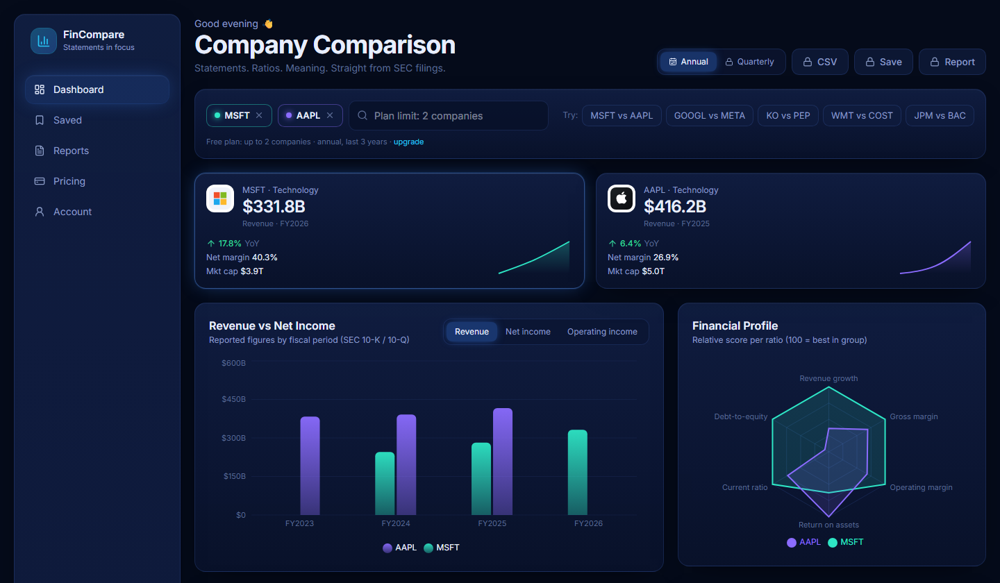
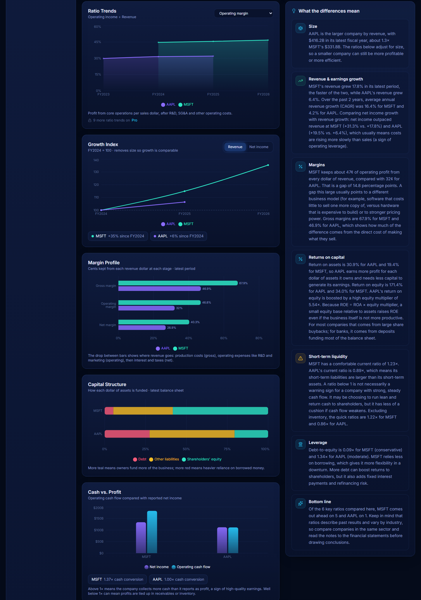
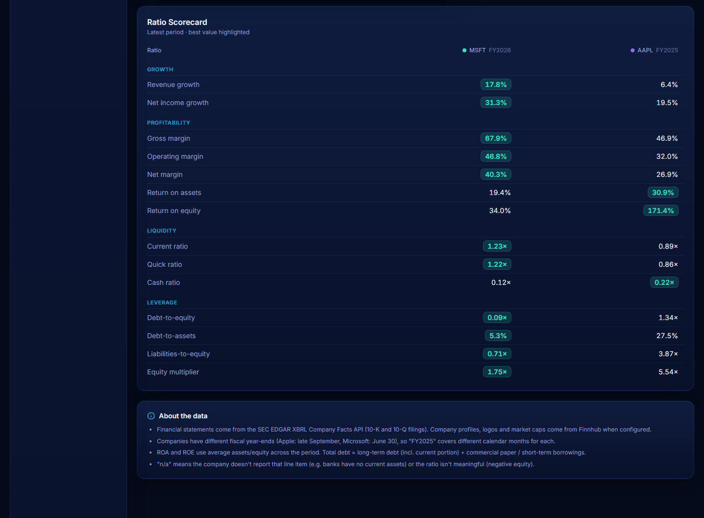
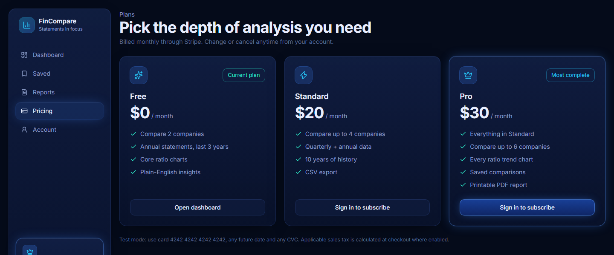

# FinCompare — Financial Statement Analysis & Company Comparison Tool

Applied Finance & FinTech prototype · Built with Claude Code · Next.js 15, TypeScript, Recharts, Supabase, Stripe

- **Live application:** https://fin-compare-plum.vercel.app
- **Repository:** https://github.com/nickelthomas05/fin-compare

## Purpose

Analyzing financial statements by hand is slow, and comparing companies is hard: every firm uses different fiscal year-ends, line-item names and scales. FinCompare retrieves companies' official 10-K and 10-Q financial statements from the SEC, normalizes them into comparable annual and quarterly series, calculates profitability, liquidity, leverage and growth ratios, visualizes the comparison with interactive charts, and explains in plain English what the differences mean financially (for example, *why* Microsoft keeps 47¢ of operating profit per revenue dollar versus Apple's 32¢).

## Screenshots

**Company overview — KPI tiles, revenue vs. net income, financial profile radar**


**Analysis — ratio trends, growth index, margin profile, capital structure, cash vs. profit, and plain-English explanations**


**Ratio scorecard — 14 ratios side by side, best value highlighted**


**Subscription plans — Free, $20 Standard, $30 Pro (Stripe test mode)**


## Main functionality

| Project requirement | How FinCompare meets it |
| --- | --- |
| Select at least two publicly traded companies | Searchable picker over every SEC registrant (ticker or name) plus one-click presets such as MSFT vs AAPL; 2–6 companies depending on plan |
| Retrieve financial statement information | SEC EDGAR XBRL Company Facts API (income statement, balance sheet, cash flow), supplemented by Finnhub company profiles (logo, industry, market cap, price) |
| Calculate profitability, liquidity and leverage ratios | 14 ratios (see [Financial concepts](#financial-concepts-and-calculations)) for every period |
| Compare revenue and net income across reporting periods | Annual (10-K) and quarterly (10-Q) series; Revenue vs Net Income chart, Growth Index, year-over-year growth and CAGR |
| Present interactive financial charts | 8 charts with hover tooltips and metric/ratio switchers: revenue/net income bars, ratio trends, growth index, margin profile, capital structure, cash vs. profit, radar profile, KPI sparklines |
| Explain the financial meaning of the differences | Rule-based analyst narrative covering size, growth, margins, returns (DuPont), liquidity, leverage and a bottom-line scorecard |

Additional features: Supabase accounts (email + password), Stripe subscriptions with three tiers (Free $0 / Standard $20 / Pro $30), CSV export, saved comparisons and a printable report.

### Minimum functional requirements checklist

| # | Requirement | Where |
| --- | --- | --- |
| 1 | Working application | Live at https://fin-compare-plum.vercel.app, or run locally (below) |
| 2 | Financial data integration from a documented source | SEC EDGAR + Finnhub — see [Data sources and APIs](#data-sources-and-apis) |
| 3 | User interaction | Pick companies, switch annual/quarterly, switch chart metrics and ratios, export, save |
| 4 | ≥ 3 meaningful financial calculations | 14 ratios + YoY growth, CAGR, growth index, cash conversion, capital structure |
| 5 | ≥ 2 charts | 8 interactive charts |
| 6 | Error handling | See [Error handling](#error-handling) |
| 7 | Documentation (purpose, data, methodology, limitations) | This README |
| 8 | Reproducibility | [Run it locally](#run-it-locally-no-accounts-needed) — tested on a fresh clone with no API keys |

## Run it locally (no accounts needed)

The core comparison tool runs with **no API keys or accounts**. Supabase (accounts), Stripe (billing) and Finnhub (logos/market cap) are optional.

**Prerequisites:** [Node.js 20+](https://nodejs.org) (includes npm) and Git.

```bash
git clone https://github.com/nickelthomas05/fin-compare.git
cd fin-compare
npm install
```

Create your environment file from the template:

```bash
cp .env.example .env.local
```

(On Windows Command Prompt use `copy .env.example .env.local`.) Then open `.env.local` and set one value — the SEC asks every API user to identify themselves:

```
SEC_USER_AGENT="FinCompare yourname@example.com"
```

Start the app and open http://localhost:3000:

```bash
npm run dev
```

You should see Microsoft vs Apple load automatically. Try other presets or search for any US-listed company. Without Supabase configured, the app runs on the Free plan (2 companies, annual data, 3 years).

Run the tests:

```bash
npm test
```

> **Windows tip:** clone into a short path such as `C:\dev\fin-compare`. Very long folder paths can exceed Windows' 260-character limit during `npm run build`.

### Dependencies

`package.json` and `package-lock.json` are this project's equivalent of `requirements.txt`; `npm install` installs the exact versions from the lockfile. Main dependencies: `next` 15.5, `react` 19, `recharts` (charts), `@supabase/supabase-js` + `@supabase/ssr` (auth/database), `stripe` (billing), `zod` (input validation), `lucide-react` (icons); dev: `typescript`, `vitest`, `eslint`, `tailwindcss`, `tsx`.

### Optional: accounts, billing and company profiles

1. **Finnhub** — free key at https://finnhub.io → `FINNHUB_API_KEY`. Adds logos, industry, market cap and price.
2. **Supabase** — create a project, run `supabase/migrations/20261020000000_init.sql` in the SQL editor, and set `NEXT_PUBLIC_SUPABASE_URL`, `NEXT_PUBLIC_SUPABASE_ANON_KEY`, `SUPABASE_SERVICE_ROLE_KEY`. For demos, disable "Confirm email" under Authentication → Providers → Email.
3. **Stripe** (use a sandbox / test mode) — set `STRIPE_SECRET_KEY`, then run `npm run stripe:setup`. It creates the Standard and Pro products and prices (lookup keys `fincompare_standard_monthly`, `fincompare_pro_monthly`) and a Customer Portal configuration; put the printed `STRIPE_PORTAL_CONFIGURATION_ID` in `.env.local`.
4. **Stripe webhooks (local)** — with the [Stripe CLI](https://docs.stripe.com/stripe-cli): `stripe listen --forward-to localhost:3000/api/stripe/webhook`, and copy the `whsec_...` secret into `STRIPE_WEBHOOK_SECRET`.

Test card: `4242 4242 4242 4242`, any future date, any CVC.

## Data sources and APIs

| Source | Endpoint | Used for | Key |
| --- | --- | --- | --- |
| SEC EDGAR company list | `https://www.sec.gov/files/company_tickers.json` | Ticker → CIK lookup and company search | None (requires a descriptive `User-Agent`) |
| SEC EDGAR XBRL Company Facts | `https://data.sec.gov/api/xbrl/companyfacts/CIK##########.json` | All reported financial statement values from 10-K and 10-Q filings | None |
| Finnhub Company Profile 2 | `https://finnhub.io/api/v1/stock/profile2?symbol=` | Company name, logo, industry, market capitalization | Free API key (optional) |
| Finnhub Quote | `https://finnhub.io/api/v1/quote?symbol=` | Latest share price and daily change | Free API key (optional) |

**XBRL tags used** (US-GAAP taxonomy; the first available tag per period wins, because companies switch tags over time):

| Line item | Tags (priority order) |
| --- | --- |
| Revenue | `RevenueFromContractWithCustomerExcludingAssessedTax`, `Revenues`, `SalesRevenueNet` |
| Cost of revenue | `CostOfGoodsAndServicesSold`, `CostOfRevenue`, `CostOfGoodsSold` |
| Gross profit | `GrossProfit` (else revenue − cost of revenue) |
| Operating income | `OperatingIncomeLoss` |
| Net income | `NetIncomeLoss`, `ProfitLoss` |
| Operating cash flow | `NetCashProvidedByUsedInOperatingActivities` |
| Balance sheet | `Assets`, `AssetsCurrent`, `LiabilitiesCurrent`, `Liabilities` (else total liabilities & equity − equity), `StockholdersEquity`, `InventoryNet`, `CashAndCashEquivalentsAtCarryingValue` |
| Debt | `LongTermDebt` (or noncurrent + current portion) + `CommercialPaper` / `ShortTermBorrowings` |

SEC data is public and free; the SEC limits clients to 10 requests per second. Responses are cached in memory and (when Supabase is configured) in the `company_financials` table for 24 hours.

## Methodology

1. **Retrieve** a company's full XBRL fact set from SEC EDGAR by CIK.
2. **Normalize** into periods:
   - *Annual:* duration facts of 340–380 days from 10-K/10-Q filings, keyed by period end date; when a value is restated, the most recently filed one is kept.
   - *Quarterly:* 80–100-day facts from 10-Qs. Q4 is not reported separately, so it is derived as full year − (Q1 + Q2 + Q3). Quarters of the current fiscal year are included before its 10-K is filed.
   - *Fiscal year label:* the calendar year of the period end (retailers ending in January are assigned to the prior year).
3. **Calculate** ratios for every period (formulas below). Balance-sheet denominators use the average of the opening and closing balances.
4. **Compare** companies on the same fiscal-period labels and rank them on each ratio.
5. **Explain** the results with rules: thresholds such as a current ratio below 1.0, a debt-to-equity ratio above 1.5, or a margin gap over 10 percentage points trigger specific explanations, and the DuPont identity explains when leverage inflates ROE.

## Financial concepts and calculations

| Category | Measure | Formula | What it tells you |
| --- | --- | --- | --- |
| Growth | Revenue / net income growth | (Current − prior) ÷ \|prior\| (quarterly: vs. same quarter last year) | How fast sales and profits are expanding |
| | CAGR | (Last ÷ first)^(1/years) − 1 | Smoothed average annual growth |
| | Growth index | Value ÷ value in first shared period × 100 (quarterly: trailing 12 months) | Growth on a common scale, regardless of company size |
| Profitability | Gross / operating / net margin | Gross profit, operating income, net income ÷ revenue | Share of each sales dollar kept after each layer of cost |
| | Return on assets (ROA) | Net income ÷ average total assets | How efficiently assets generate profit |
| | Return on equity (ROE) | Net income ÷ average shareholders' equity | Return earned on owners' capital |
| Liquidity | Current ratio | Current assets ÷ current liabilities | Ability to pay obligations due within a year |
| | Quick ratio | (Current assets − inventory) ÷ current liabilities | Same test, excluding slow-to-sell inventory |
| | Cash ratio | Cash & equivalents ÷ current liabilities | Most conservative liquidity test |
| Leverage | Debt-to-equity | Total debt ÷ equity | Reliance on borrowing vs. owners' capital |
| | Debt-to-assets | Total debt ÷ total assets | Share of assets funded by debt |
| | Liabilities-to-equity | Total liabilities ÷ equity | All obligations vs. equity (works for banks) |
| | Equity multiplier | Average assets ÷ average equity | DuPont leverage factor: ROE = ROA × equity multiplier |
| Earnings quality | Cash conversion | Operating cash flow ÷ net income | Whether reported profit is backed by cash |
| Structure | Capital structure | Debt, other liabilities, equity ÷ total assets | How the business is funded |

Ratios show "n/a" when inputs are missing (e.g. banks don't report current assets) or not meaningful (equity-based ratios when equity is negative). Quarterly ROA/ROE are annualized (× 4).

## Error handling

| Situation | Behavior |
| --- | --- |
| Unknown ticker | Clear message: "Unknown ticker … Pick a US-listed company that files with the SEC." |
| Fewer than two companies, or malformed input | Input is sanitized; message asks for at least two companies |
| Foreign filer with no US-GAAP data (e.g. TSM) | Message explains that IFRS / Form 20-F filers aren't supported |
| Missing line items | Affected ratios display "n/a"; charts skip missing points; explanations adapt (e.g. banks) |
| SEC EDGAR slow or unavailable | 20-second timeout; falls back to the last cached copy when available; otherwise a "try again shortly" message (no crash) |
| Finnhub unavailable or no key | 5-second timeout; profiles are simply omitted |
| Plan limits exceeded | Server-side check with an upgrade prompt |
| Supabase or Stripe not configured | Accounts and billing are disabled with an explanatory note; comparisons still work |
| Checkout failure | Error message shows which step failed (customer, price, session) without exposing secrets |

## Architecture

```
Browser ──► Next.js App Router (Vercel)
             ├─ /api/compare   → EDGAR companyfacts → normalize → ratios → explain   (cached in Supabase)
             ├─ /api/tickers   → EDGAR company_tickers.json
             ├─ /api/export    → CSV (Standard+)
             ├─ /api/saved     → Supabase saved_comparisons (Pro, row-level security)
             ├─ /api/stripe/checkout → Stripe Checkout (subscription)
             ├─ /api/stripe/portal   → Stripe Customer Portal (upgrade/downgrade/cancel, invoices)
             ├─ /api/stripe/webhook  → verifies signature → syncs subscriptions table
             └─ /api/health    → reports which Stripe account / Supabase project is connected (IDs only)
```

| Path | Contents |
| --- | --- |
| `lib/edgar.ts`, `lib/finnhub.ts` | API clients |
| `lib/normalize.ts` | XBRL → annual/quarterly statement rows |
| `lib/ratios.ts` | Ratio definitions and calculations |
| `lib/explain.ts` | Rule-based explanations |
| `components/` | Dashboard and charts |
| `supabase/migrations/` | Database schema and security policies |
| `tests/` | Unit tests for normalization, ratios and explanations |

### Plans

| | Free $0 | Standard $20/mo | Pro $30/mo |
| --- | --- | --- | --- |
| Companies per comparison | 2 | 4 | 6 |
| History | Annual, 3 years | Annual + quarterly, 10 years | Annual + quarterly, 10 years |
| Ratio trend charts | 6 core | 6 core | All 14 |
| CSV export | — | ✓ | ✓ |
| Saved comparisons, printable report | — | — | ✓ |

Limits are enforced on the server, not only in the UI.

## How the AI coding agent was used

I built FinCompare with **Claude Code** (Anthropic) as an AI pair programmer. I set the requirements (the assignment brief, the three pricing tiers, Supabase and Stripe, the visual design) and made the product decisions; Claude Code:

- **Planned** the architecture and asked clarifying questions (stack, folder, pricing tiers, sign-in method) before writing code.
- **Implemented** the data pipeline, ratio engine, explanations, charts, authentication, billing and database schema.
- **Verified against real data**, for example checking that Microsoft's ~47% and Apple's ~32% operating margins match their filings, and that quarterly figures such as Apple's FY24 Q4 net income match the 10-Q/10-K.
- **Found and fixed bugs during testing**, including revenue tags that changed over time, quarterly durations hidden inside 10-K filings, a growth index that compared different base years, dashboard scroll lag, and a Vercel integration that silently replaced the Stripe and Supabase keys.
- **Wrote unit tests** and the documentation, and helped deploy to Vercel.

All AI-generated code was reviewed, run and tested before being committed.

## Known limitations and incomplete features

- **US-GAAP filers only.** Foreign companies reporting under IFRS (Form 20-F/40-F) aren't supported.
- **XBRL coverage varies.** Some companies use custom tags or omit line items, so some ratios show "n/a". Banks and insurers don't report current assets/liabilities, so liquidity ratios don't apply to them.
- **Fiscal years differ.** Apple's FY2025 ends in September and Microsoft's in June, so the same label covers different calendar months.
- **Derived Q4.** Q4 is calculated as full year − Q1–Q3; restatements between filings can make it slightly off. Quarterly cash flow is only reported year-to-date, so quarterly cash conversion uses the latest period with both figures.
- **Rule-based explanations.** Narratives use fixed thresholds and don't account for industry norms or one-time events.
- **Billing is in test mode.** Stripe runs in a sandbox — no real payments. Sales tax (Stripe Tax) is disabled because no tax registration is configured.
- **Not implemented:** industry/peer benchmarks, valuation ratios (P/E, EV/EBITDA), a true downloadable PDF (the Pro report uses the browser's "Save as PDF"), and email notifications.
- **Data delay.** Figures update when companies file with the SEC; cached data refreshes every 24 hours.

## Security

No API keys, passwords or tokens are committed. Secrets live in `.env.local` (git-ignored) and in the hosting provider's environment settings; `.env.example` lists the variable names only. Database tables use row-level security, Stripe webhooks are signature-verified, and the service-role key is used only on the server.

## Scripts

| Command | |
| --- | --- |
| `npm run dev` | Development server at http://localhost:3000 |
| `npm test` | Unit tests (Vitest) |
| `npm run lint` / `npm run build` / `npm start` | Lint / production build / run the production build |
| `npm run stripe:setup` | Idempotent Stripe product, price and portal setup |

## Deploying to Vercel

Import the repository at https://vercel.com/new and add the environment variables from `.env.local`. **If Vercel's Stripe or Supabase marketplace integration is attached to the project, it replaces `STRIPE_SECRET_KEY` and `NEXT_PUBLIC_SUPABASE_*` with keys for accounts it created.** Set `FINCOMPARE_STRIPE_SECRET_KEY`, `FINCOMPARE_SUPABASE_URL`, `FINCOMPARE_SUPABASE_ANON_KEY` and `FINCOMPARE_SUPABASE_SERVICE_ROLE_KEY`, which take priority (`lib/env.ts`), and check `GET /api/health`. Create a Stripe webhook endpoint for `https://<your-domain>/api/stripe/webhook` and set `STRIPE_WEBHOOK_SECRET`.

Stripe Tax: Checkout enables `automatic_tax` only when `STRIPE_AUTOMATIC_TAX=true`. Turn it on only after adding a head office address and at least one tax registration (Dashboard → Tax); without a registration Stripe silently collects $0. Set `STRIPE_TAX_CODE` from the [Tax Codes API](https://docs.stripe.com/tax/tax-codes) and rerun `npm run stripe:setup`.
